# KloudKIT • hubridge

> 🌉 Your bridge to mission control

Install it with the command in hubd's Settings › Access:

```sh
curl -fsSL '<hubd>/install?code=<code>' | sh                          # hubd's bundled build
curl -fsSL '<hubd>/install?code=<code>' | sh -s -- --version latest   # or a tag, such as v0.1.0
```

`hubridge update [--version bundled|latest|<tag>]` updates it and saves the channel. Outside a
pinned tag it also updates itself every 6 hours; `HUBRIDGE_NO_AUTOUPDATE=1` turns that off.
`hubridge help` lists the commands. The protocol it speaks is in
[kloudkit/hubd](https://github.com/kloudkit/hubd/tree/main/protocol).

## Instructions

hubridge writes the instructions the operator keeps in hubd into `~/.claude/rules/hubd/`
(under `CLAUDE_CONFIG_DIR` when it is set), where Claude Code loads them as personal rules. It
writes the files hubd sends and none of its own. It fetches them after every connect and on
hubd's `sync` command, and retries a failed fetch after 5 seconds, then at doubling intervals
up to 5 minutes, until it succeeds or the connection closes. A 404, which a reverse proxy
answers during a deploy, keeps the files as they are.

`rules.json` in its home lists the files hubridge wrote, with their contents. When the daemon
starts, before it reaches hubd, it rewrites any of them that is missing or changed, so a
recreated container gets its instructions back while hubd is down. A new machine gets them at
its first connect. When hubd stops sending a file, hubridge removes it; it removes only files
it wrote and leaves anything else in the folder alone.

## Status file

The daemon keeps `~/.claude/hubd/status.json` (under `CLAUDE_CONFIG_DIR` when it is set) saying
whether it is connected to hubd. The hubd footer mod for Claude Code reads it, to show `hubd`
while hubridge is connected and `hubd offline` when it is not; with no file, it shows nothing.

```json
{
  "state": "offline",
  "since": "2026-11-08T09:00:00Z",
  "machine": "ws",
  "url": "https://hubd.example.com",
  "version": "v0.4.0",
  "error": "connection refused"
}
```

`state` is `connected` or `offline`, and `since` is when it last changed, in UTC. `url` is the
hubd it connects to, without credentials. Only `offline` carries `error`, a short reason with
no URL or token in it: `starting` when the daemon starts, before it connects; `stopped` when it
shuts down; otherwise why the last connection ended or the last attempt failed, such as
`connection refused`, `HTTP 502`, `token revoked` or `refused: protocol 1 too old`.

The daemon rewrites the file atomically when it starts, on every `welcome` from hubd, when a
connection ends or an attempt fails, and when it stops; while the state holds, only a new
reason rewrites it. A daemon that is killed leaves the file as it was, until it starts again.
`hubridge doctor` reports the state, its age and the reason.

## License

Released under the [**MIT License**](https://github.com/kloudkit/hubridge/blob/main/LICENSE),
**except** the [`brand/`](https://github.com/kloudkit/hubridge/tree/main/brand) directory.

The hubridge and KloudKIT logos, icons and other brand assets are proprietary and
**all rights reserved**; see [`brand/LICENSE`](https://github.com/kloudkit/hubridge/blob/main/brand/LICENSE).
